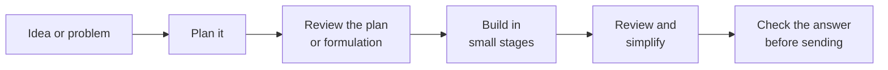

# AI skills for careful analytics work

*For people using AI agents in analytical work.*

AI agents such as Claude and Codex write analysis and model code quickly, but
left to themselves they tend to skip the discipline: they don't question the
formulation, they build everything in one go, and they rarely check their own
work. The skills in this repo add those missing steps, so an agent works more
like a careful analyst would:



They are useful for data science, forecasting, optimization and operations
research projects as well as ordinary software. They structure how the agent
plans, builds and reviews; they don't choose the right method or guarantee
correct results for you. They come from workflows used in real projects.

Some skills need extra setup or an external service; each skill's page says
what.

## What's here

| When you want to… | Skill | Agent | Analytics example |
| --- | --- | --- | --- |
| Think a project through before any code is written | [Feature planning](coding/feature-planning/) | Codex | Decide how a demand-forecasting pipeline should handle new products before building it |
| Catch errors in a plan, spec or mathematical formulation | [Spec and formulation review](coding/algo-tech-document-review/) | Claude | Check an LP/MIP model for wrong indices, missing constraints and unit mix-ups |
| Build something substantial one checked stage at a time | [Staged implementation](coding/staged-agent-implementation/) | Codex | Build a churn model: data prep, features, training, evaluation, each reviewed before the next |
| | [Phased build from a validated spec](coding/algo-tech-implementation/) | Claude | Implement a reviewed allocation model in phases, with plain, readable code |
| Get a second, independent opinion | [Peer review](coding/peer-review/) | Codex (with Claude, Gemini or Codex as reviewer) | Have a second agent challenge a SQL query, notebook or model write-up |
| Tidy working code without changing its results | [Simplify](coding/simplify/) | Codex | Clean up a messy pandas script while keeping its output identical |
| Get a review automatically after every coding turn | [Auto-review hook](coding/auto-review/) | Codex | When a turn changes your analysis code, the agent is asked to review and simplify it |
| Check an answer before the agent sends it | [Answer check](quality/jev-check/) | Claude | Score a summary of results for unsupported claims before it reaches a stakeholder |

Each skill is currently written for the agent shown, but the workflows
aren't tied to it: you can implement any of them in either Claude or Codex.

Each skill's page explains what it does, how to use it, and anything it needs.

## Try it

Claude picks up a skill on its own when your request matches it. In Codex,
you name the skill with `$skill-name`.

```text
Review this facility-location formulation before we code it. Check every index,
constraint and unit, and ask me about anything that's ambiguous.
```

```text
Use $staged-agent-implementation to build the forecasting pipeline in
docs/forecast_plan.md one stage at a time. Show me the stages first and wait
for my go-ahead before each one.
```

```text
Use $simplify on clean_sales.py. The output CSV must stay exactly the same.
```

## Get the skills

- **Claude app (web, desktop, mobile):** download a skill's zip from the
  [latest release](https://github.com/arviphd/ai-skills/releases/tag/skills)
  and upload it in Claude under **Customize → Skills → + → Create skill →
  Upload a skill**.
- **Claude Code or Codex:** clone the repo and copy the skills you want into
  your skills folder. See [INSTALL.md](INSTALL.md) for one-line commands for
  macOS, Linux and Windows.

## How the repo is organised

Skills are grouped by purpose. Inside each skill there is one folder per AI
agent, so the Claude and Codex versions sit side by side:

```text
coding/peer-review/
  README.md     what the skill does and how to use it
  codex/        the Codex version
  claude/       the Claude version, when there is one
```

| Folder | What's in it |
| --- | --- |
| `coding/` | Planning, building and reviewing analysis, model and software projects |
| `quality/` | Checking an agent's answers before they are sent |
| `editor/` | A small VS Code customization ([details](editor/vscode/antigravity-gemini-sidebar/)) |

## License

[MIT](LICENSE): free to use, adapt and share.
